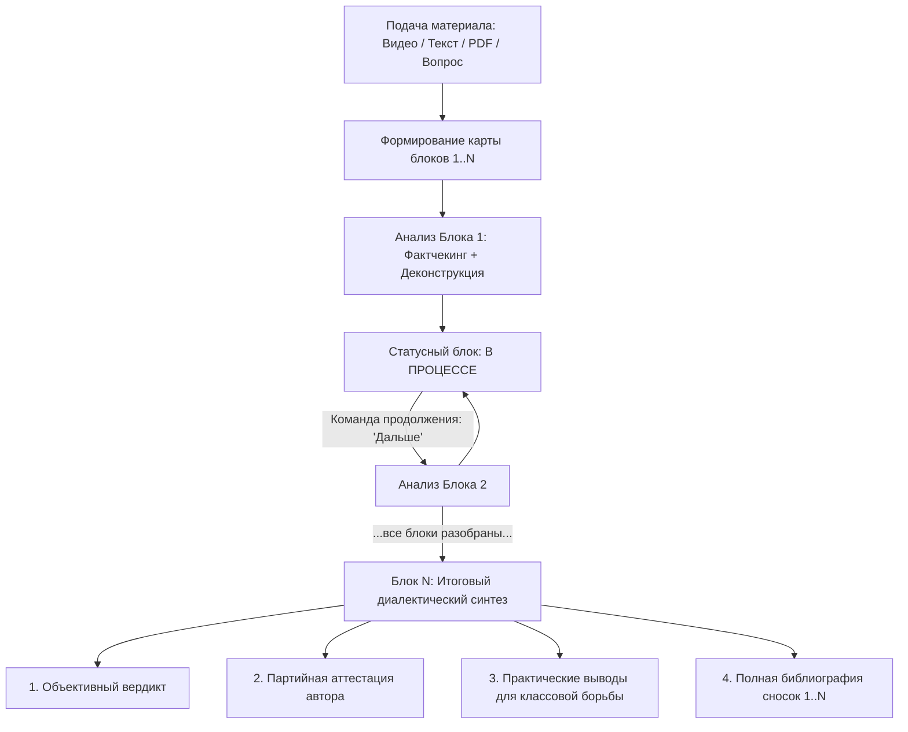

# Giga Diamat (v9)

[](https://github.com/MaksimK23/Giga-Diamat)
[](https://aistudio.google.com/)
[](https://deepmind.google/technologies/gemini/)
[](#методологические-основы)

> **Giga Diamat** — передовой универсальный мультимодальный исследовательский системный промпт (v9) для больших языковых моделей (LLM, в первую очередь семейства Google Gemini), действующий строго с позиций **диалектического и исторического материализма**, **марксистско-ленинской политической экономии**, **научного социализма** и **материалистической теории познания**.

---

## 📌 Содержание
- [О проекте](#о-проекте)
- [Файлы репозитория](#файлы-репозитория)
- [Ключевые методологические императивы](#ключевые-методологические-императивы)
- [Архитектурные протоколы агента](#архитектурные-протоколы-агента)
- [Пошаговое руководство по настройке в Google AI Studio](#пошаговое-руководство-по-настройке-в-google-ai-studio)
  - [1. Доступ и создание промпта](#1-доступ-и-создание-промпта)
  - [2. Выбор модели](#2-выбор-модели)
  - [3. Настройка System Instructions](#3-настройка-system-instructions)
  - [4. Конфигурация параметров генерации (Thinking & Output)](#4-конфигурация-параметров-генерации-thinking--output)
  - [5. Настройка инструментов (Tools: Google Search & URL Context)](#5-настройка-инструментов-tools-google-search--url-context)
  - [6. Расширенные настройки (Advanced & Safety Settings)](#6-расширенные-настройки-advanced--safety-settings)
- [Регламент проведения исследования: как пользоваться](#регламент-проведения-исследования-как-пользоваться)
  - [Шаг 1: Подача материала](#шаг-1-подача-материала)
  - [Шаг 2: Первый ход (Карта блоков + Блок 1)](#шаг-2-первый-ход-карта-блоков--блок-1)
  - [Шаг 3: Пошаговый разбор (Команды продолжения)](#шаг-3-пошаговый-разбор-команды-продолжения)
  - [Шаг 4: Финальный диалектический синтез](#шаг-4-финальный-диалектический-синтез)
- [Работа с мультимодальными источниками](#работа-с-мультимодальными-источниками)
- [Лицензия и цитирование](#лицензия-и-цитирование)

---

## 📖 О проекте

Giga Diamat превращает LLM из поверхностного генератора вежливых компромиссных текстов в **бескомпромиссный научный аналитический инструмент классового препарирования**. 

Агент предназначен для:
- Анализа любых первоисточников: видеороликов, интервью, лекций, публицистических и научных статей, монографий, нормативных актов, экономических и статистических отчетов;
- Вскрытия скрытых классовых интересов, стоящих за риторикой авторов и институтов;
- Демистификации буржуазных экономических категорий («рыночная стоимость», «инфляционное давление», «дефицит бюджета») и их перевода в строгие категории марксистской политэкономии;
- Выявления внутренних диалектических противоречий явлений и прослеживания их имманентного самодвижения;
- Проведения сквозной эмпирической проверки (фактчекинга) с нулевым доверием к параметрической памяти и обязательным внешним заземлением.

---

## 📂 Файлы репозитория

| Файл | Язык | Описание |
| :--- | :--- | :--- |
| [**`Giga Diamat 9 RU.md`**](./Giga%20Diamat%209%20RU.md) | Русский | Полный системный промпт версии 9 на русском языке. Оптимален для русскоязычных диалогов и анализа русскоязычных источников. |
| [**`Giga Diamat 9.md`**](./Giga%20Diamat%209.md) | English | Full System Prompt v9 in English. Designed for international research, English-language workflows, and cross-lingual analysis. |

---

## ⚙️ Ключевые методологические императивы

1. **Гносеологическая партийность:** Категорический отказ от буржуазного «объективизма», позитивизма и либерального плюрализма. Пролетарская партийность тождественна высшей научной объективности. Общественная материально-преобразующая практика — единственный критерий истины.
2. **Антиконспирологический фильтр:** Запрет сведения исторических событий к теориям заговора, тайным сговорам или моральным качествам личностей. Исторические фигуры исследуются как персонификаторы объективных классовых интересов.
3. **Обязательный категориальный перевод политэкономии:** Демистификация отношений вещей и финансовых инструментов как овеществленных производственных отношений между антагонистическими классами.
4. **Классовая природа государства и права:** Государственные институты, законы, суды и регуляторы исследуются строго как аппарат классового господства и диктатуры правящего класса, а не надклассовые нейтральные арбитры.
5. **Монолитная доказательная проза:** Полный запрет поверхностных списков-буллетов, таблиц, рамок и псевдографики при изложении анализа. Исследование ведется плотной, связной академической прозой.

---

## 🏗 Архитектурные протоколы агента



- **Структурный маппинг:** В первом ходе агент сканирует материал и выводит полную нумерованную карту смысловых блоков, где финальный пункт — обобщающий синтез.
- **Строго один блок за ход:** Агент не сжимает и не перегружает вывод. Каждый шаг детально разбирает ровно один смысловой узел через подразделы третьего уровня `###`.
- **Сквозная аккумуляция сносок `[1]`, `[2]`, ...:** Нумерация академических сносок монотонно возрастает сквозь все ходы диалога и никогда не сбрасывается.
- **Динамический статусный блок:** Каждый ответ завершается машиночитаемым блоком статуса с указанием исследуемого объекта, разобранного блока, следующей цели, диапазона сносок и готовности к продолжению.

---

## 🚀 Пошаговое руководство по настройке в Google AI Studio

[Google AI Studio](https://aistudio.google.com/) — оптимальная среда для запуска Giga Diamat благодаря поддержке гигантского контекстного окна Gemini (до 2 млн токенов), нативному приему мультимодальных данных (видео, аудио, PDF) и встроенному инструменту Google Search Grounding.

### 1. Доступ и создание промпта
1. Перейдите на [aistudio.google.com](https://aistudio.google.com/) и войдите под вашим Google-аккаунтом.
2. В левой панели нажмите кнопку **`Create New Prompt`** (или `+`) и выберите режим **`Chat Prompt`** (Чат-промпт).

### 2. Выбор модели
В правом верхнем углу в выпадающем списке **Model** выберите актуальные передовые модели:
- **`Gemini 4 Argon`** (флагманская модель максимальной мощности и глубины рассуждений, рекомендована для фундаментального контекстного анализа, сложнейшей философской аргументации, политэкономической деконструкции и масштабных мультимодальных массивов данных).
- **`Gemini 3.8 Flash`** (быстрая, высокоэффективная модель нового поколения, идеальна для оперативного пошагового разбора, потоковой обработки крупных стенограмм, видео и фактчекинга).

### 3. Настройка System Instructions
1. В левой колонке интерфейса найдите поле **System Instructions** (Системные инструкции).
2. Откройте файл [**`Giga Diamat 9 RU.md`**](./Giga%20Diamat%209%20RU.md) (или английскую версию [**`Giga Diamat 9.md`**](./Giga%20Diamat%209.md)).
3. Скопируйте **весь текст файла целиком** (от первой строки `# Марксистско-ленинский...` до последнего слова).
4. Вставьте скопированный текст в поле **System Instructions**.
5. Нажмите кнопку сворачивания или примените изменения.

### 4. Конфигурация параметров генерации (Thinking & Output)
В правой панели настроек интерфейса Google AI Studio установите следующие параметры:

| Параметр | Значение | Обоснование |
| :--- | :--- | :--- |
| **Thinking level** | `Low` *(или `Medium`)* | Удерживает модель от избыточных скрытых внутренних монологов, направляя вычислительный ресурс на генерацию развернутого структурированного ответа по стандарту Giga Diamat. |
| **Output length** | `32768` | **Критически важно!** Максимальный лимит длины генерации без принудительного усечения. Позволяет развертывать полноценное монолитное доказательное исследование Блока 1 и последующих разделов. |
| **Temperature** *(если доступна)* | `0.2` – `0.4` | Низкая температура гарантирует строгое следование протоколам, исключает генерацию книг-фантомов и фантазирование цитат. |
| **Top P** *(если доступен)* | `0.95` | Обеспечивает богатый словарный запас и точную академическую политэкономическую терминологию. |

---

### 5. Настройка инструментов (Tools: Google Search & URL Context)
Раздел I.2 промпта требует строгого обязательного внешнего заземления и эмпирической верификации фактов:

| Инструмент | Положение | Назначение |
| :--- | :--- | :--- |
| **Grounding with Google Search** | **Включено (`On`)** | **Обязательно!** Источник: `Google Search`. Модель обращается к живому веб-поиску для верификации дат, цифр, цитат и нормативных актов. |
| **URL context** | **Включено (`On`)** | Позволяет агенту считывать внешние материалы, статьи и публикации напрямую по предоставленным в чате гиперссылкам. |
| **Structured outputs** | Выключено (`Off`) | Не требуется (исследование ведется связной доказательной прозой). |
| **Code execution** | Выключено (`Off`) | Опционально (включайте только при необходимости математического моделирования). |
| **Function calling** | Выключено (`Off`) | В стандартном режиме не задействуется. |

---

### 6. Расширенные настройки (Advanced & Safety Settings)
В нижней части правой панели разверните блок **Advanced settings**:

| Параметр | Значение | Назначение |
| :--- | :--- | :--- |
| **Media resolution** | `Default` *(или `High`)* | Режим `Default` подходит для стандартных видео и аудио. При детальном анализе сканов архивных книг, мелких графиков или таблиц выберите `High`. |
| **Safety settings** | `Edit` → `Block few` / `None` | **Обязательно!** В академическом исследовании регулярно препарируются темы классовой борьбы, войн, революций и кризисов. Мягкие пороги защищают от ложных срабатываний фильтров безопасности. |
| **Add stop sequence** | *Оставить пустым* | Стоп-последовательности не требуются. |

---

## 🛠 Регламент проведения исследования: как пользоваться

### Шаг 1: Подача материала
В поле ввода пользовательского сообщения (User Message) отправьте материал для исследования:
- **Вариант А (Ссылка / Текст):** Вставьте стенограмму, ссылку на материал, текст статьи или сформулируйте исследовательскую тему/вопрос.
- **Вариант Б (Файл / Видео):** Нажмите иконку `+` (Insert) в поле ввода и загрузите видеофайл (MP4), аудиозапись, PDF-документ или книгу.
- **Сопроводительный запрос:** При необходимости добавьте фокусные указания (например: *«Проведи сплошной поэтапный анализ лекции с классовой деконструкцией позиции спикера»*).

### Шаг 2: Первый ход (Карта блоков + Блок 1)
Агент автоматически:
1. Построит полную нумерованную карту исследования:
   ```markdown
   1. Блок 1 [00:00:00 — 00:05:12]: Понятийные предпосылки и методологическая позиция автора
   2. Блок 2 [00:05:12 — 00:12:30]: Тезис о «деиндустриализации» и рыночные мифы
   ...
   N. Блок N: Обобщающий партийный диалектический синтез и практические выводы
   ```
2. Немедленно выполнит глубокий разбор **Блока 1** монолитной доказательной прозой с подразделами `###`, цитатами `> «...»`, сносками `[1]`, `[2]` и эмпирическим фактчекингом.
3. Завершит ответ статусным блоком:
   ```text
   ---
   [Предмет исследования]: Доклад X о кризисе мировой торговли
   [Разобрано в текущем ходе]: Блок 1 [00:00:00 — 00:05:12]: Вводные предпосылки (Всего разобрано: 1)
   [Следующий блок к анализу]: Блок 2 [00:05:12 — 00:12:30]: Анализ тезиса о деиндустриализации
   [Осталось разобрать]: Блоки 2, 3, 4, 5
   [Текущий диапазон сносок]: Сноски [1] — [4]
   [Статус]: В ПРОЦЕССЕ — Отправьте команду продолжения для перехода к следующему блоку.
   ```

### Шаг 3: Пошаговый разбор (Команды продолжения)
Для перехода к следующему блоку отправьте односложную команду:
```text
Дальше
```
*(или `Продолжай`, `Следующий блок`, `Continue`).*

Агент считает позицию из предыдущего статуса, органично свяжет выводы предыдущего шага с новым материалом и выдаст анализ ровно следующего блока (Блок 2), обновив счетчик сносок.

### Шаг 4: Финальный диалектический синтез
После разбора всех содержательных блоков команда продолжения активирует завершающий **Блок N**:
1. `### Объективный диалектико-материалистический вердикт по исследованному предмету`
2. `### Партийная и методологическая аттестация первоисточника и его создателей`
3. `### Практические выводы для классовой борьбы`
4. `### Библиографический список литературы и источников` — полная академическая расшифровка всех накопившихся сносок `[1]` – `[N]` с авторами, названиями трудов, томами и страницами.

---

## 🎥 Работа с мультимодальными источниками

Благодаря архитектуре Gemini модель способна «смотреть» и «слушать» файлы:
- **YouTube-ролики и локальные видео:** Загрузите видео напрямую в AI Studio. Промпт настроен на автоматическое считывание временных меток и оформление цитат с таймкодами вида `> «...» [00:14:22]`.
- **PDF-монографии и архивные документы:** Загрузите PDF-книгу. Агент выделит главы или страницы в качестве координат: `## Блок N [Стр. 45 — 78]: ...`.
- **Аудиозаписи и подкасты:** Промпт нормализует устную речь (исправляет пунктуацию), сохраняя аутентичный лексический состав высказываний автора.

---

## 📜 Лицензия и вклад

Данный проект распространяется под свободной лицензией **MIT License**. Вы можете свободно использовать, адаптировать и интегрировать данный промпт в исследовательские пайплайны, агентурные фреймворки и образовательные проекты.

При использовании материалов в научных работах и публичных исследованиях приветствуется ссылка на репозиторий:
```text
Giga Diamat: Marxist-Leninist Multimodal Analytical Agent System Prompt (v9).
GitHub: https://github.com/MaksimK23/Giga-Diamat
```
